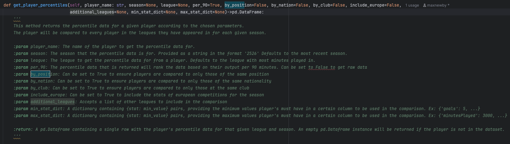
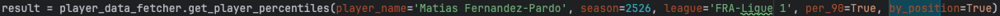
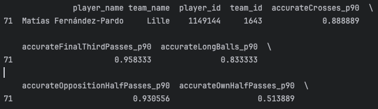
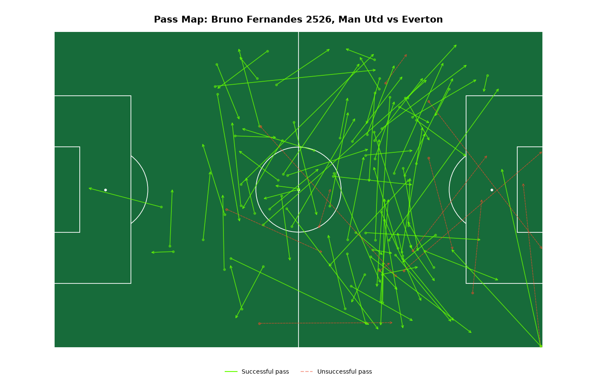
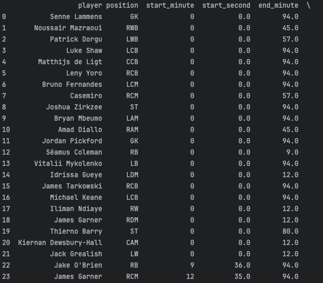

# FootballApplicationProject-Info

Code is kept private, but this page talks through and shows some of the things that this project contains.

An ongoing project that aims to create an application to give view, compare and use player statistics to estimate performance, and the effectiveness of their tactical ideas. Using player data from Sofascore and match event data from WhoScored to build new datasets and visualisations

## Notable milestones so far:

- Functions to collect player percentile data compared against any chosen series of conditions by combining data from Sofascore with data from Transfermarkt.

- Percentile Dataframe, totalling 91 columns

- Function to generate pass maps for any player for any half for any games based off WhoScored match event data:

- New datasets that use WhoScored's position data and timing data throughout the game to accurately map a player's stats per position that they have played. Currently totalling 78 columns of data

- Inital UI design that is not ready to share

## Next steps:

- Provide functions to map other stats such as shots or dribbles.
- Finalising a plan for UI design that allows users to move markers on tactic boards to create up their own defensive and attacking setups for each team.
- Producing a feedback system to the user of the pros and cons of their ideas based on suitability of a player for a given role based statistical data of players for the season, as well as the formation matchups.

### Further into the future

- Functions to generate tactical dashboards for a given game based on match event data.
- Fun score simulation aspect to the application where two people can mix and match players based on their data from previous seasons, and create fantasy matchups.